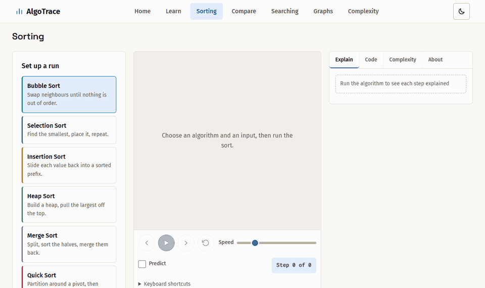
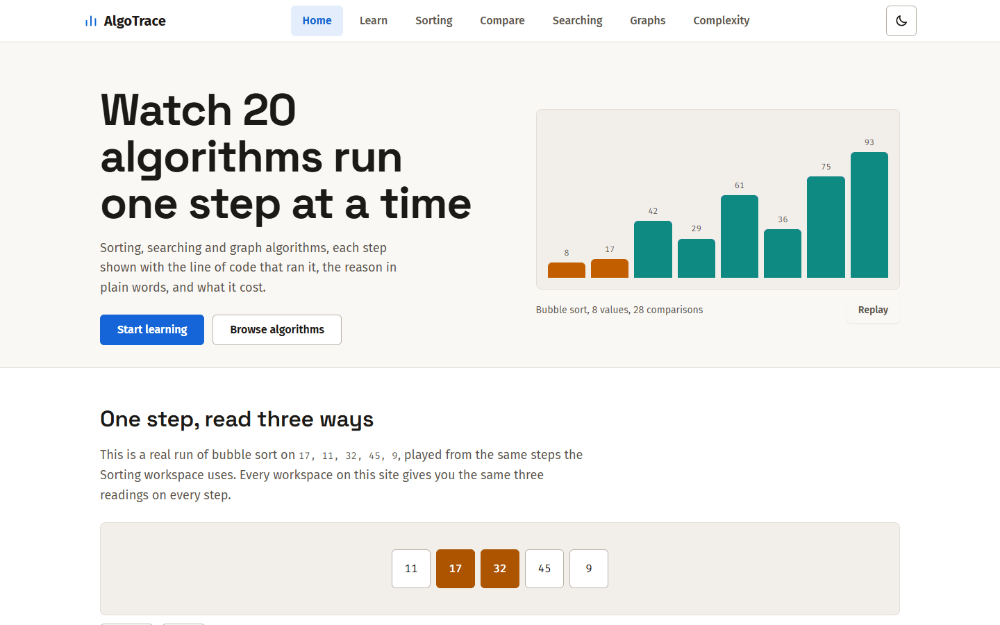
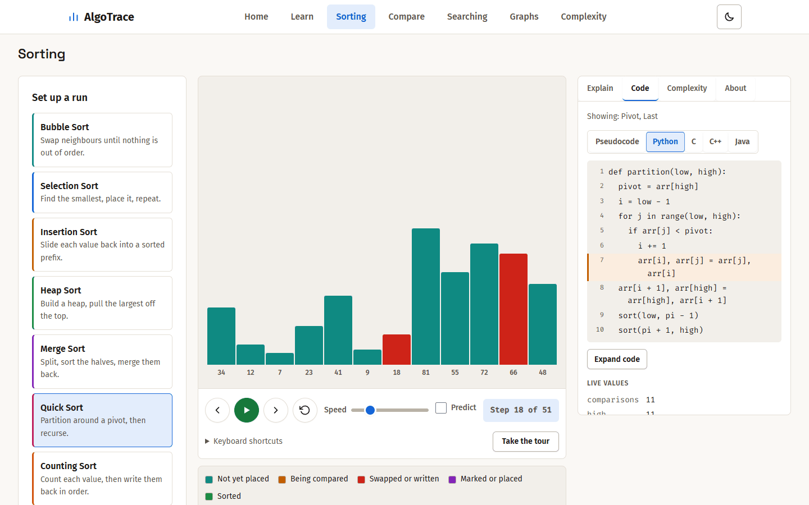
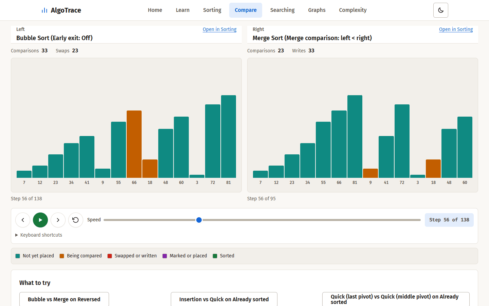
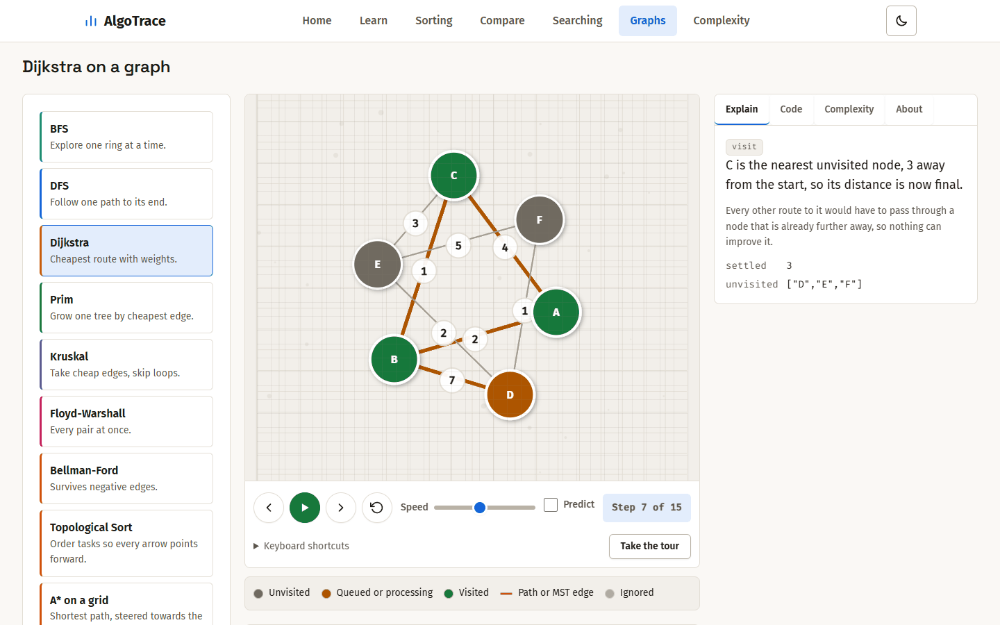
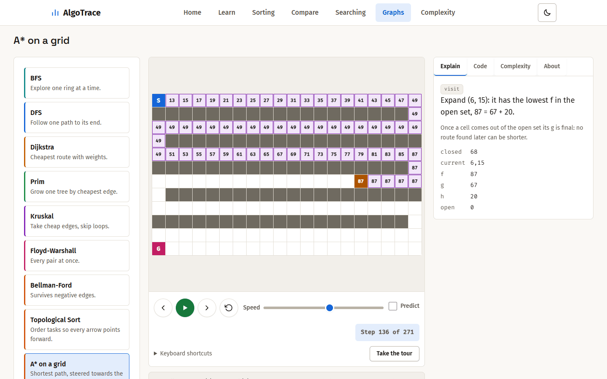
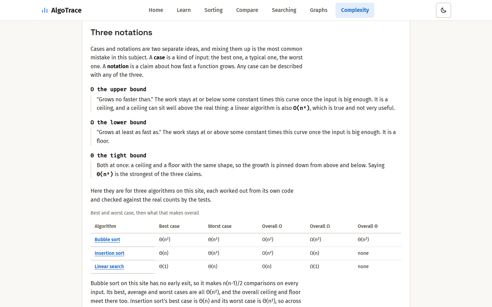
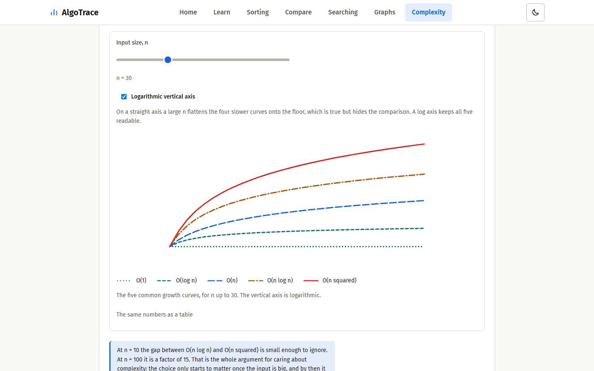

# AlgoTrace

AlgoTrace plays 20 sorting, searching and graph algorithms one step at a time on input you choose, putting a plain language reason, the line of code that ran and a running count of the work beside every move.

**Live demo:** TODO, add the address here after the first deploy.



## Screenshots

| | |
|---|---|
|  |  |
| Home: a real bubble sort in the hero, and one step read three ways | Sorting: quick sort mid-run, the Learn panel on Code |
|  |  |
| Compare: two sorts on one input, side by side | Graphs: Dijkstra mid-run, the current step explained |
|  |  |
| A*: searching a grid with walls you draw | Complexity: O, Omega and Theta, worked out for real code |
|  | |
| Complexity: the five growth curves, each in its own colour and line style, with a legend | |

The screenshots are captured by `tools/make_screenshots.py`, in the light theme at 1440 pixels wide. The site also has a dark theme.

## Features

- **20 algorithms.** Eight sorts (bubble, selection, insertion, heap, merge, quick, counting, radix), three searches (linear, binary, jump), eight graph algorithms (BFS, DFS, Dijkstra, Prim, Kruskal, Floyd-Warshall, Bellman-Ford, topological sort) and A* on a grid you draw walls on.
- **One step at a time.** Each algorithm yields a step for every comparison, swap or write. Play, pause, step forward and back, change the speed, or use the keyboard. The page replays the real steps; it never guesses what changed between frames.
- **A reason for every move.** The Explain tab says what the step did in one sentence with the real values, and why.
- **Five code views.** Pseudocode, Python, C, C++ and Java, with the running line highlighted and the live variables beside it. The C, C++ and Java listings come from real programs in `reference_code/` that the tests compile and run against the Python.
- **O, Omega and Theta.** Each algorithm's best, average and worst case with the tight bound of each, a worked example, the extra memory it needs, and the count from your run beside what the formula predicts. The text describes this code, not the textbook.
- **A short guided tour.** The first time you open Sorting, Searching, Graphs or A*, five steps light up the real controls (pick an algorithm, choose an input, play and the keyboard shortcuts, the Learn panel, Predict). It is shown once per workspace, can be skipped or closed with Esc, and the Take the tour button in the control bar plays it again.
- **Predict mode.** Switch it on and the run pauses to ask what happens next: will these two swap, which node is visited next, which cell is expanded next. Your score is kept for the run.
- **Compare.** Two sorts on one input, side by side, one set of controls for both, with a counter for each.
- **Recursion tree.** Merge sort and quick sort draw their calls as a tree that grows as the sort runs.
- **Input presets.** Random, already sorted, reversed, nearly sorted and all equal, so the best and worst cases are one click away.
- **Variants.** Merge sort with a stable or unstable merge, quick sort with three pivot rules (last, middle, random with a seed), bubble sort with or without an early exit.
- **Built to be used by everyone.** Keyboard operable throughout, text at 4.5:1 contrast in light and dark, reduced motion respected, no sideways scrolling at 375, 768 or 1440 pixels. No accounts, no database, no analytics.

## Tech stack

- **Server:** Python 3.11, Flask 3 and Jinja2 templates. The algorithms are plain Python generators; the graph algorithms are in `app.py`.
- **Browser:** vanilla JavaScript and plain CSS, no framework, no bundler, no build step. D3 7 draws the graphs and is served from this repository, not a CDN.
- **Production:** gunicorn on Linux and waitress on Windows, a Render blueprint (`render.yaml`), a Content-Security-Policy with a nonce on every inline script, and a per-address rate limit on the endpoints that run an algorithm.
- **Tests:** pytest, and Playwright driving a real Chromium for layout, themes, reduced motion and the policy. The C, C++ and Java reference programs are compiled with `gcc`, `g++` and a JDK and compared with the Python step for step.

## Run it locally

Python 3.11 or newer.

### For development

```bash
python -m venv .venv
.venv\Scripts\activate
pip install -r requirements.txt
python app.py
```

The site is then at http://localhost:5002. `python app.py` starts Flask's
development server with debug mode **off**. Turn debug mode on, for the reloader
and the in-browser traceback, only on your own machine:

```powershell
$env:FLASK_DEBUG = "1"; python app.py
```

### As a production server, locally (Windows)

`requirements.txt` installs `waitress` on Windows and `gunicorn` on Linux. The
entry point for both is `wsgi.py`. To run the site the way it runs on Render,
from the project folder in PowerShell:

```powershell
.venv\Scripts\activate
pip install -r requirements.txt
$env:SITE_URL = "http://localhost:8000"
waitress-serve --host=127.0.0.1 --port=8000 wsgi:app
```

Then open http://localhost:8000. On Linux or macOS the same thing is
`SITE_URL=http://localhost:8000 gunicorn wsgi:app --bind 127.0.0.1:8000`.

### Environment variables

| Variable | What it does | If unset |
|---|---|---|
| `SITE_URL` | The public address, with no trailing slash, for canonical links, `sitemap.xml`, `robots.txt` and social previews. Set it to `https://your-domain` when the custom domain is attached; no code changes. | Links use the address the request came to, which is right locally and wrong behind a proxy. |
| `SECRET_KEY` | Flask's secret key. The site keeps no sessions, so nothing uses it today. It is read from here so a future feature never needs one committed. | No key is set. |
| `FLASK_DEBUG` | `1` turns on Flask's debug mode, for `python app.py` on your own machine only. | Off. |
| `TRUST_PROXY` | `1` to believe `X-Forwarded-Proto`, `X-Forwarded-Host` and `X-Forwarded-For` from the one proxy in front, as on Render. The rate limit then counts the real client address, not the proxy's. | Not trusted. |
| `RATE_LIMIT_PER_MINUTE` | How many requests one address may make to the `/run_*` endpoints in a minute. Over it, the answer is a JSON 429 that the pages show as "wait N seconds and try again". `0` turns it off. | 30 |
| `PORT` | The port `python app.py` listens on. A production server takes its port from its own command line. | 5002 |

### Deploying

`render.yaml` is a Render blueprint for the `main` branch of
https://github.com/Yash-Maithani/AlgoTrace: it installs `requirements.txt`, starts
`gunicorn wsgi:app` on `$PORT`, pins Python 3.11, and expects `SITE_URL` to be
filled in on the dashboard. `Procfile` holds the same start command for hosts
that read one. [LAUNCH_CHECKLIST.md](LAUNCH_CHECKLIST.md) lists what is left to
do by hand.

The `/run_*` endpoints are rate limited per address (`ratelimit.py`, standard
library only, a sliding minute). The counts live in one process, so under
gunicorn with two workers an address can make up to twice the limit; that is
enough to stop a loop, which is what it is for. Pages and static files are not
limited.

Pages carry a Content-Security-Policy that allows this site's own scripts and
styles and the Google Fonts it imports, with a fresh nonce on every inline
script, so there are no inline event handlers in the markup. Static files are
served with a content hash in their address and a one year cache; pages are
revalidated on every visit. D3 is served from `static/vendor/`, not a CDN, so the
graph pages work offline.

## Run the tests

Install the test tools once. Playwright drives a real browser, which is how the
reduced motion, width and theme checks run against the CSS the site ships:

```bash
python -m pip install -r requirements-dev.txt
python -m playwright install chromium
```

The second line downloads Chromium (about 150 MB, once). If you skip it, the
browser tests use a Chrome or Edge that is already installed, and if there is
none they skip. A run without them says so in a warning at the top and the
bottom, so a green result is never mistaken for a complete one. Browser tests
are in `tests/test_browser_phase14.py` and the files that follow it.

Two ways to run them:

```bash
pytest -q
```

```bash
pytest -q -m "not slow"
```

The first runs everything. The second leaves out the tests marked `slow`, the
ones that measure how counts grow across many input sizes, the ones that
compile and run the C, C++ and Java reference programs, and every test that
drives a real browser. It runs about 2,150 tests in about a minute; the full set
is about 2,900 and takes about 20 minutes with the browser tests. Use the quick
run while working and the full set before a commit. Run the full set on its own:
two at once starve each other and make the browser tests time out. The marker is
registered in `pytest.ini`.

The compile tests need `gcc`, `g++` and a JDK 17 or newer (`javac` and `java`)
on the path. Without one, that language's tests skip and say what to install.

Most tests exist to prove that visual work did not change any algorithm's
behaviour:

| File | What it holds to account |
|---|---|
| `test_sorting_parity.py` | Every sort's output, comparison count and swap count against a baseline recorded before the rebuild, over 17 inputs |
| `test_graph_parity.py` | Every `/run_*` endpoint's step array, byte for byte, against its own recorded baseline, including disconnected, negative weight and negative cycle graphs |
| `test_lessons.py` | Every lesson file has the fields the step contract requires |
| `test_searching.py` | Found first, middle and last; not found; duplicates; size one; binary search blocked on unsorted input |
| `test_sorting_workspace.py`, `test_graph_workspace.py` | The ids and hooks the shared workspace code depends on |
| `test_big_o.py` | Every figure the Big O page quotes, re-derived by running the code |
| `test_kruskal.py` | Union-find behaviour on disconnected input |
| `test_variants.py` | Every variant switch: output, counts, stability, seeds, and each lesson claim measured against the code |
| `test_phase11.py` | Each case's stated Theta, checked by growing the input and counting real work (slow) |
| `test_reference_code.py` | The C, C++ and Java sorts and searches, compiled and run, match the Python step by step (slow) |
| `test_compare.py`, `test_browser_phase17.py` | `/compare`: counts equal `/run_sort`'s, both sides finish and the shorter waits, every "What to try" sentence holds, layout at 375 to 1440 in both themes, reduced motion, and the three workspaces still run after the refactor (browser half slow) |
| `test_reference_graphs.py` | The C, C++ and Java graph programs match every `/run_*` endpoint step by step on the recorded graphs and on generated ones built to hit ties, negative weights and negative cycles (slow) |
| `test_code_listings.py` | The listings generated from those programs are current and use the lesson's line ids |
| `test_phase14b.py` | Every visible source line is in its generated listing, and a statement over several lines carries its id on all of them |
| `test_browser_phase14.py` | In a real browser: reduced motion, the Code panel in every language, the Complexity tab for every algorithm and variant, no sideways scroll at 375, 768 and 1440 in both themes |
| `test_phase15.py`, `test_browser_phase15.py` | The Home player: its steps are the real `/run_sort` steps, all four cards change together on every step, it starts and pauses with the viewport, and under emulated reduced motion it stays on its frozen step while Step still works |
| `test_phase16.py`, `test_browser_phase16.py` | Predict mode: every question the builders ask, over real runs of every algorithm, has an answer that matches the step that really follows and options taken from the run; in a browser, the flow, the score, Step back, autoplay waiting, keyboard, widths and themes |
| `test_predict_neutral.py` | Predict options taken from the run are listed by name or position, never in the order the algorithm takes them: over many random runs of eight algorithms no position holds the answer more than 60 percent of the time, no prompt says which end of a queue or stack is taken, and A* never asks a question that push order decides |
| `test_review_fixes22.py` | /learn and Home's "Start here" share one order and every count comes from the registry; /learn's figures are read from the lesson files; the Merge and Heap wording; the graph copy and labels; every graph page draws its starter graph before a run, and an edit throws the run away and redraws |
| `test_random_range.py` | One range for every random value, 1 to 99: server random arrays, presets and the searching page; every preset at every size runs on every sort, so Compare never refuses a generated input |
| `test_phase21.py`, `test_browser_phase21.py`, `test_reference_grid.py` | A*: on 400 random grids the path is as short as a BFS shortest path and valid, no path is reported exactly when BFS finds none, A* never expands more cells than Dijkstra, the tie-break and stale entries, the endpoint's refusals, the cases measured (Theta(1) and Theta(V log V) heap comparisons), the presets, the Predict question against the real open set; in a browser, drawing and erasing walls by pointer and by keyboard, moving start and goal, the Dijkstra button and result line, and the page at 375, 768 and 1440 in both themes; C, C++ and Java take the same steps with the same heap comparisons |
| `test_phase20.py`, `test_browser_phase20.py` | Topological sort: on 300 random DAGs every arrow u to v has u before v; on 300 graphs with a planted cycle the run stops, names the nodes left, and the cycle it reports is real; the step meta; exactly 2(V + E) + 1 steps on a DAG; Theta(V + E) measured; the Predict question against the real queue; in a browser, arrowheads that stop at the node's rim, no arrows on the seven undirected pages, badges and strip at 375, 768 and 1440 in both themes, step back, the random DAG generator and reduced motion |
| `test_phase19.py`, `test_browser_phase19.py` | Jump, Counting and Radix: sorted output and found index against Python's `sorted` and `index` on random, sorted, reversed, all equal, duplicate and edge-size inputs; zero comparisons; the 0 to 99 rule and its messages; every worked figure; Theta per case measured (n + k over a grid of n and k, d(n + b) as n and d grow, 1 and square root of n); the three new Predict questions against the real steps; in a browser, the strips at 375, 768 and 1440 in both themes with no bar clipped, reduced motion, and the Compare banner counting steps when a side never compares |
| `test_phase18.py`, `test_browser_phase18.py` | The call tree matches the recursion the real merge and quick sort functions made (found by profiling them, not from the step meta) for 200 runs across every variant; in a browser, the toggle, stepping forward and back, large arrays, both themes, and the seven item navbar at desktop widths |
| `test_browser_visibility.py` | What is on screen, asked of the browser rather than read from an attribute: only the chosen algorithm's variant switch, the seed only for a random pivot, on /sorting and both sides of /compare |
| `test_browser_review_fixes.py` | A run is cleared when its input changes (sorting and searching), every graph page opens with a runnable graph, every Learn panel says what to do before a run, the graph canvas and A* grid have a role and a name, and the Counting Sort count list reads at 4.5:1 in both themes |
| `test_compression.py`, `test_browser_compression.py` | Large JSON and HTML are gzipped only for a client that accepts it and only over 1 KB, with correct `Content-Encoding`, `Content-Length` and `Vary`; the decompressed body equals the plain one byte for byte; over a real connection a 100 value bubble sort arrives at a few percent of its size and every page and run still works |
| `test_privacy.py`, `test_browser_privacy.py` | The privacy page names exactly the localStorage keys the code uses, no cookie or other storage is set, the page says how to clear them, and its table fits at 375, 768 and 1440 in both themes |
| `test_launch_prep.py`, `test_browser_launch.py` | The AlgoTrace name, meta and Open Graph tags on every page, `SITE_URL` in canonical links, `robots.txt` and `sitemap.xml`, the 404 and 500 pages, cache busting and cache headers, the security headers and a nonce on every inline script, self-hosted D3, the production files; in a browser with the policy on and the network off, every page and every algorithm runs with no policy violations |
| `test_tour.py`, `test_browser_tour.py` | The tour is loaded by exactly the four workspace pages and stores one key through guarded calls, adds nothing the policy would have to allow, and its wording has no dashes; in a real browser with the policy on: it shows once per workspace on a first visit (all graph algorithms share one), five steps each light their own control, the card stays on screen without covering the control at 375, 768 and 1440 in both themes, Skip, Back, Next, Done and Esc work and are remembered, Take the tour replays it and leaves the workspace as it was, focus moves in, stays in and returns, each step is announced, nothing animates under reduced motion, a blocked localStorage breaks nothing |
| `test_browser_link_styles.py` | In a real browser, on every page at 375, 768 and 1440 in both themes: no visible link is painted in the browser's default blue or purple and every one reads at 4.5:1; a link darkens and thickens its underline on hover and shows a solid ring on keyboard focus; the "One input for both" fieldset has the same border, colour and radius as the algorithm pickers; the `/big-o` growth chart gives each of its five curves its own colour and dash, with a matching legend, and keeps its description and table |
| `test_rate_limit.py`, `test_browser_rate_limit.py` | The sliding minute, one count per address, the 31st run refused with a JSON 429 and a `Retry-After`, pages and static files never limited, a forged `X-Forwarded-For` ignored unless `TRUST_PROXY=1`, the limit read from the environment; in a browser, every page that runs an algorithm tells the student how long to wait |
| `test_icons_and_contact.py` | The PNG icons are the stated sizes, every page links them and the manifest, the manifest names real icons and the site's own colours, the policy allows them, and `/terms` points to the GitHub issues page with no email address |
| `test_browser_learn_loading.py` | /learn with its figure script held back: every figure slot shows a placeholder, no card, row or tag changes size when the figures arrive, at 375, 768 and 1440 in both themes |

Two more checks are not pytest:

```bash
python tools/check_banned_patterns.py .
node tests/validate_lessons.js
python tools/extract_code.py --check
```

The first enforces the project's writing rules against em dashes and emoji. It
decodes JavaScript escapes, surrogate pairs and HTML entities before it looks,
because a plain search over the source misses every one of those forms and this
project has shipped all of them. The second parses every lesson file. The third
says whether the code listings need regenerating: after editing anything in
`reference_code/`, run `python tools/extract_code.py`.

## Project structure

No build step, no bundler, no frontend framework, and no CDN libraries: D3 is
self-hosted in `static/vendor/`. Plain CSS, vanilla JavaScript, Jinja templates
and one Flask file (plus `siteconfig.py` for everything a public site needs).

```
app.py                     every route, the eight graph algorithms, gzip for large responses
siteconfig.py              site name, meta tags, SITE_URL, robots.txt, sitemap.xml, site.webmanifest, 404 and 500, security and cache headers
ratelimit.py               the per-address limit on /run_*
wsgi.py                    the entry point for gunicorn and waitress
Procfile, render.yaml      how it is started and deployed on Render
.python-version            the Python it is built with
LICENSE                    MIT
grid_algorithms/           A* on a grid (Dijkstra is the same code with h = 0)
teacher.py                 the builder graph steps pass through (sorts and searches use sorting_algorithms/teacher.py)
sorting_algorithms/        eight sorts, each yielding teacher steps, plus a seeded generator
searching_algorithms/      linear, binary and jump search
reference_code/            all twenty algorithms in C, C++ and Java
templates/
  layout.html              the shell every page extends
  landing.html             Home
  learn.html               the algorithm index
  sorting.html             sorting workspace
  searching.html           searching workspace
  compare.html             two sorts side by side
  big_o.html               the complexity guide
  graph_base.html          the graph workspace and the whole D3 visualizer
  bfs.html ... etc         eight children (seven graph algorithms and topological_sort), each an information panel
  astar.html               A* on its own grid workspace
  _graph_picker.html       the algorithm picker the graph pages and A* share
  404.html, 500.html       the error pages
  privacy.html, terms.html
static/
  styles.css               the whole design system, one light set and one dark
  og-image.svg, og-image.png   the 1200 x 630 social preview (the PNG is drawn from the SVG)
  favicon.svg, favicon-32.png, icon-192.png, icon-512.png, apple-touch-icon.png   the icons (the PNGs are drawn from the SVG by tools/make_icons.py)
  vendor/                  D3 7.9.0 and its licence, with the hash the tests hold it to
  js/workspace.js          run, play, pause, step, reset, speed; more than one can share a page
  js/teacher.js            the Learn panel
  js/codeview.js           the language tabs, listings, helpers and Expand dialog
  js/predict.js            Predict mode: the question for every algorithm
  js/calltree.js           the recursion tree for merge and quick sort
  js/compare.js            the Compare page
  js/sortstage.js          the bars, shared by Sorting and Compare
  js/sortstrip.js          the count list and buckets under the bars
  js/gridstage.js          the A* grid
  js/presets.js, variants.js   input presets, variant switches
  js/growth.js, notations.js   the growth chart and the O, Omega, Theta explorer
  js/learnfigures.js       fills /learn's complexity figures from the lesson files
  js/home_player.js, home_code.js   the Home player and its code card
  js/nav.js, theme.js      the narrow header menu, the light and dark toggle
  js/tour.js               the first-visit tour of each workspace and its Take the tour button
  js/lessons/*.js          twenty lesson files, one per algorithm
  js/lessons/README.md     the step contract every phase follows
  js/lessons/code/*.js     C, C++ and Java listings, generated, never edited
tests/                     pytest suites, the two recorded baselines, and the node checks they call
tools/check_banned_patterns.py
tools/extract_code.py      writes js/lessons/code/ from reference_code/
tools/make_icons.py        draws the PNG icons from static/favicon.svg
tools/make_screenshots.py  captures docs/screenshots/ and the demo GIF with Playwright
DESIGN.md                  the design spec
REBUILD_PLAN.md            the plan the rebuild followed
LAUNCH_CHECKLIST.md        what is left before this goes live
requirements.txt, requirements-dev.txt   what runs it, and what tests it
```

### The step contract

Every step carries `action`, `indices`, `values`, `line`, `vars` and
`explain: {beginner, why}`. Sorting and searching steps keep their original
`array` and `compared` fields alongside, so the drawing code did not have to
change. Graph endpoints keep their typed step arrays and return a parallel
`meta` list of the same length. `static/js/lessons/README.md` is the
authoritative description.

### Endpoints that return steps

Every run is one POST that answers with the whole list of steps. Where the
teacher payload (`action`, `indices`, `values`, `line`, `vars`, `explain`) lives
differs by family, and is the thing to check before reading a response:

| Method | Route | Body | Returns | Teacher payload |
|---|---|---|---|---|
| POST | `/run_sort` | `algorithm`, `values` or `size`, optional `variant` and `seed` | `{steps, array, sorted, algorithm, variant, seed, result, info}` | inside each step |
| POST | `/run_search` | `algorithm`, `array`, `target` | `{steps, algorithm, array, target, result}` | inside each step |
| POST | `/run_bfs`, `/run_dfs`, `/run_dijkstra`, `/run_prim` | `{"graph": {...}, "start": "A"}` | `{steps, meta}` | parallel `meta` list |
| POST | `/run_bellman_ford` | `{"graph": {...}, "start": "A"}` | `{steps, meta, distances, has_negative_cycle, iterations}` | parallel `meta` list |
| POST | `/run_kruskal`, `/run_floyd_warshall` | `{"nodes": [...], "edges": [[u, v, w], ...]}` | `{steps, meta}` | parallel `meta` list |
| POST | `/run_topological_sort` | `{"graph": {"A": ["B"], ...}}`, each node to the nodes its arrows point to | `{steps, meta, order, remaining, cycle}` | parallel `meta` list |
| POST | `/run_astar` | `rows`, `cols`, `walls`, `start`, `goal`, optional `heuristic` | `{steps, algorithm, heuristic, grid, result}` | inside each step |
| POST | `/generate_random_graph` | `num_nodes`, `num_edges` | `{nodes, edges, message}`, a connected random graph | none |

Sorting, searching and A* steps carry the teacher payload themselves, so there
is no `meta` list for them. The graph endpoints keep their original typed step
arrays untouched and add `meta` beside them, one entry per step. Two older form
posts remain: `/` and `/sorting` run a sort on the server and open the page on
that run.

Large runs are compressed on the way out. A bubble sort of 100 values is about
7.1 MB of steps and a 26 node Floyd-Warshall run about 11.3 MB; for a client
that sends `Accept-Encoding: gzip`, any JSON or HTML response over 1 KB is sent
gzipped (the first becomes about 256 KB and the second about 693 KB), with
`Content-Encoding`, `Content-Length` and `Vary: Accept-Encoding` set. It is one
`after_request` hook in `app.py` using only the standard library, and the step
format is the same once the browser has unzipped it.

Unreachable distances come back as the string for infinity, never a bare
`Infinity`, because JSON has no infinity literal and `JSON.parse` rejects one.
`_wire()` in `app.py` is the only place that converts, and `isUnreachable()` in
`graph_base.html` is the only place that reads it.

## What is on the site

| Route | Page |
|---|---|
| `/` | Home, with a hero that runs a real bubble sort on eight bars and a player that reads one run three ways |
| `/learn` | Every algorithm, grouped, in a suggested beginner order |
| `/sorting` | Sorting workspace, eight algorithms |
| `/compare` | Two sorts side by side on one input, one transport for both |
| `/searching` | Searching workspace, three algorithms |
| `/graph?algo=...` | Graph workspace, eight algorithms, and A* on its own grid workspace (`?algo=astar`, in the same picker) |
| `/big-o` | How complexity works, with a growth chart you can drive |
| `/privacy`, `/terms` | Legal pages |

### Sorting

Bubble, Selection, Insertion, Heap, Merge, Quick, Counting and Radix, in
`sorting_algorithms/`. Each one yields a step for every comparison, swap and
write, and the page replays those steps rather than guessing what changed
between frames.

Counting Sort and Radix Sort (least significant digit first, base 10) never
compare two values. Both are told their key range in advance, whole numbers
from 0 to 99, refuse anything outside it with a message that says why, and
draw their working memory in a strip under the bars: the count list as a
hundred square, or the ten buckets of the current digit pass.

### Searching

Linear, Binary (iterative) and Jump, in `searching_algorithms/`. Binary and
jump search refuse an unsorted array instead of answering wrongly, explain
why, and offer to sort it for you. Jump search jumps a block of floor(sqrt n)
values at a time, then scans the one block that can hold the target.

### Graphs

BFS, DFS, Dijkstra, Prim, Kruskal, Floyd-Warshall and Bellman-Ford, generated
in `app.py` and drawn with D3. Dijkstra scans for its minimum linearly, Prim
uses `heapq`, Kruskal uses union-find and returns a spanning forest when the
graph is disconnected, and Bellman-Ford reports a negative cycle rather than
looping on one.

Topological Sort (Kahn's algorithm) reads its graph as one way arrows: the
format guide gives the directed input (`from to` per line), the arrows are
drawn with arrowheads, and Random makes a graph with no cycle. Each node shows
its in-degree in a badge, and a strip under the graph shows the queue of nodes
with in-degree 0 and the order as it builds. When a cycle makes an order
impossible the run stops and names the cycle and the nodes waiting on it. The
seven undirected algorithms read and draw their graphs exactly as before.

A* has a grid workspace of its own, reached from the same Graphs picker:
draw walls by clicking or dragging, drag the start and the goal, or use the
keyboard (arrow keys move a cursor, Space toggles a wall, S and G place the
start and goal). Moves go up, right, down and left at cost 1, the heuristic
is the Manhattan distance, and the open set is a binary heap ordered by lowest
f, then lowest h, then the order cells were pushed, so every run, and every
language, takes the same steps. Cells show f, or g, h and f when they are big
enough. "Run Dijkstra on the same grid" runs the same code with h = 0, and
the closing line compares the cells each expanded on that one grid. Presets:
Empty, Wall with a gap, Simple maze, No path.

### Predict mode

The control bar on every workspace has a **Predict** switch, off by default. When it
is on, the run pauses before some steps and asks what happens next: whether a
compared pair will swap, whether a search finds, goes left or goes right, which
node a graph search visits or joins next. The answer is read from the step that
really follows and the options come from the run's own queue, stack or
unvisited set. A score counts the run, Skip is always there, and Step back never
re-asks an answered question. The questions are built in `static/js/predict.js`;
the shared shell only asks it whether a step may play. Every algorithm has a
question: bubble sort "will these two swap?", selection sort "is this the new
smallest value?", insertion sort "will this value shift right?", merge sort
"which half is written next?", quick sort "is it smaller than the pivot?", heap
sort "will the parent move down?", counting sort "which count goes up?", radix
sort "which bucket does this value go into?", jump search "jump again or scan
back?", Kruskal "added, or a cycle?", Bellman-Ford
"will this edge shorten the distance?" and Floyd-Warshall "is the path through
k shorter?" and topological sort "which node is removed next?" and A* "which cell is expanded next?". A run with no step that can be asked about says so instead.

### The call tree

Under the stage on /sorting, Merge Sort and Quick Sort draw their recursion as a
tree of boxes (`static/js/calltree.js`). It is built only from the `depth` and
`range` every step of those two sorts already carries, so it agrees with the
stage by construction and works for every variant. A box appears when its call
starts, the call at work is highlighted and announced in words, finished calls
dim, and a merge call shows its merged result when it finishes. It is open by
default from 900px up and collapsed below, and a large tree scrolls inside its
own box.

### The Learn panel

Four tabs beside every visualization, driven by `static/js/teacher.js`:

- **Explain**: the current step in one sentence, with the real values, plus a
  one line reason. Updates on every step, forwards and backwards.
- **Code**: pseudocode, Python, C, C++ or Java, the running line highlighted, and
  the live variables beside it.
- **Complexity**: best, average and worst, each tied to a line of the code; a
  worked example at n = 5; auxiliary space; and the count from this run beside
  what the formula predicts for this n.
- **About**: the idea in three sentences, an analogy, and when to reach for it.

The complexity text describes this code, not the textbook. Bubble sort here has
no early-exit flag, so its best case is quadratic. Quick sort takes the last
element as its pivot, so a sorted array is its worst case. Heap sort's
`heapify` recurses, so it carries a logarithmic stack. Merge sort allocates
while merging and is not stable.

## Accessibility and motion

Every page is keyboard operable end to end, with a visible focus ring on every
stop. Text meets 4.5:1 in both themes, state is never carried by colour alone,
and the colour keys name every state in words. Every animation has a
`prefers-reduced-motion` fallback that stops the movement and keeps the state
colours, so nothing is hidden by turning motion off. Checked at 375px, 768px
and 1440px.

## Licence

MIT, copyright 2026 Yash Maithani. See [LICENSE](LICENSE). D3 in `static/vendor/`
keeps its own ISC licence, `d3-LICENSE.txt`.

## Author

Yash Maithani. Source and issues: https://github.com/Yash-Maithani/AlgoTrace
